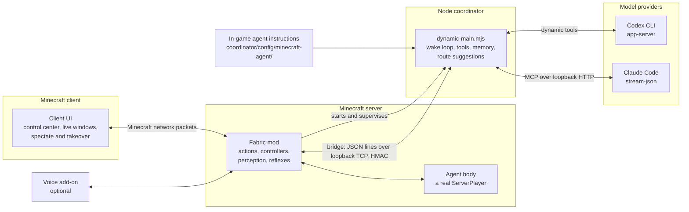
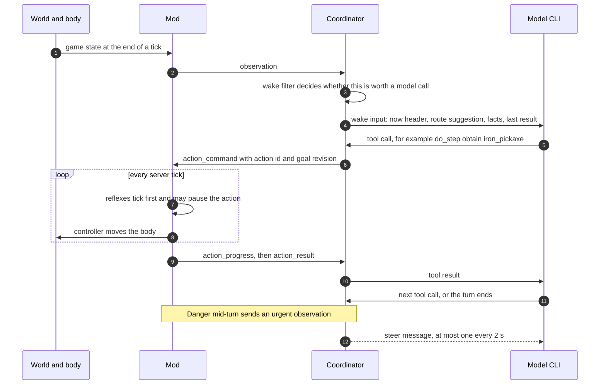
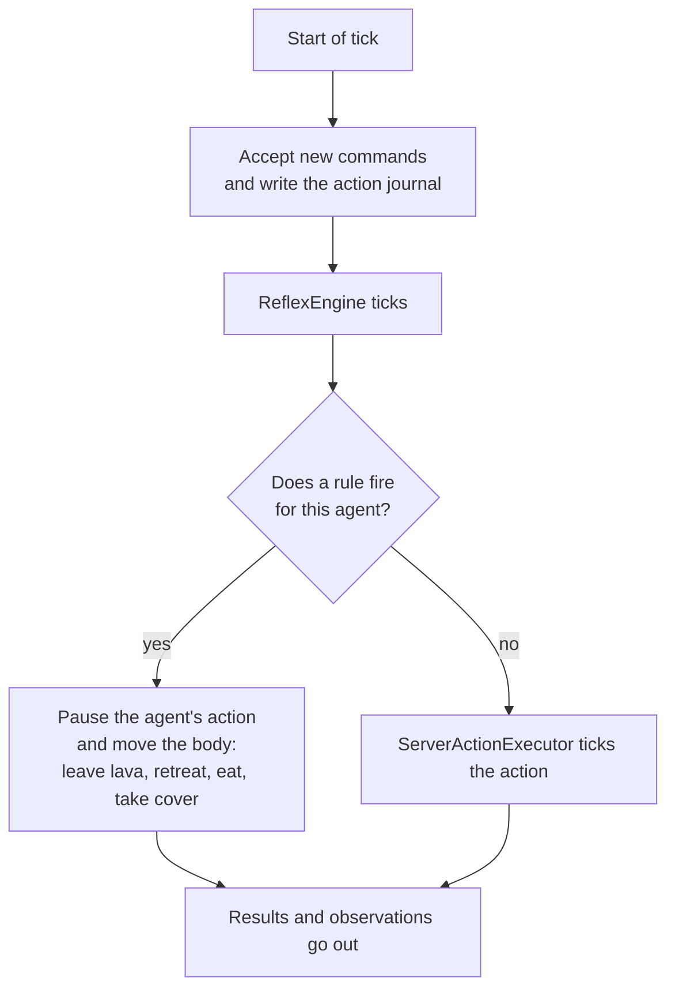
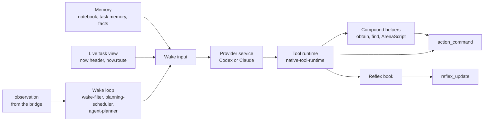
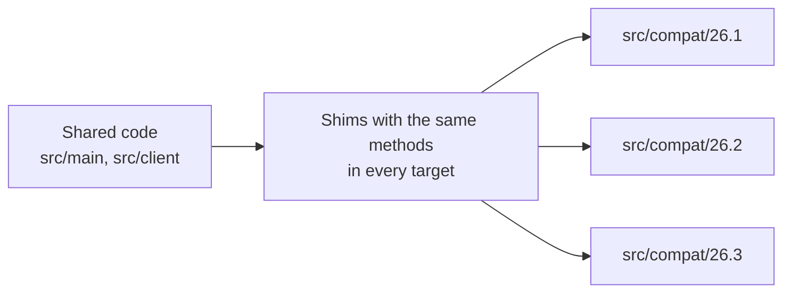
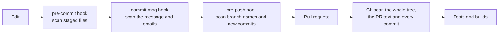

# Architecture

This page draws out every part of Mineagen and how the parts talk to each other. Start here if you are new to the code. For how far agents get through a full game, and where runs get stuck, read [docs/goal-progress.md](docs/goal-progress.md) and [docs/architecture.md](docs/architecture.md).

## The whole system

Mineagen has two halves that run side by side:

- A **Fabric mod** inside the Minecraft server. It owns the agent's body: a real player that moves, mines, fights and crafts at normal game speed.
- A **Node coordinator**. It owns the agent's mind: it wakes a model, hands it Minecraft tools and memory, and turns tool calls into body actions.

The mod starts the coordinator as a child process. The two talk over one loopback TCP connection, the **bridge**. The model itself is an ordinary CLI you already use, Codex or Claude Code, which the coordinator drives.

| System | Where it lives |
|---|---|
| Mod runtime | `src/main/java/dev/agaminggod/mineagen/` |
| Client UI | `src/client/java/dev/agaminggod/mineagen/` |
| Bridge | `src/main/java/dev/agaminggod/mineagen/server/bridge/MultiplexedServerBridge.java` and `coordinator/src/protocol-v2.mjs` |
| Coordinator | `coordinator/src/`, started by `coordinator/src/dynamic-main.mjs` |
| In-game agent instructions | `coordinator/config/minecraft-agent/` |
| Minecraft version shims | `src/compat/26.1/`, `src/compat/26.2/`, `src/compat/26.3/` |
| Benchmarks and quality tools | `scripts/quality/`, `coordinator/src/benchmark/`, `scripts/decision-eval/` |
| Publication gate and CI | `scripts/check-public-tree.mjs`, `scripts/hooks/`, `.github/workflows/` |
| Voice add-on | `voice-addon/` |

## One agent turn

A turn starts when something happens in the world and ends when the model stops calling tools. The model never touches the game directly: every body action goes through the coordinator and the bridge, and the mod reports back what really happened.

Two rules hold this loop together. Each agent has at most one model turn and one body action in flight. Every command carries the goal revision and an action id, and both sides refuse work from an old revision.

## Mod runtime

The mod is the body. It runs inside the server tick, so it reacts in 50 ms steps while the model takes seconds to answer.

**Entry points.** `src/main/resources/fabric.mod.json` names `Mineagen.java` (server) and `src/client/java/dev/agaminggod/mineagen/client/MineagenClient.java` (client). `server/AgentServerRuntime.java` hooks the server lifecycle: on start it creates `server/CoordinatorProcessSupervisor.java`, which launches and watches the Node coordinator, and it opens the bridge. `server/AgentManager.java` creates and stores agents.

Java paths in this section are relative to `src/main/java/dev/agaminggod/mineagen/`.

### Actions and controllers

The coordinator asks for work as an **action**. `protocol/ActionType.java` lists every action type, from low-level input (`move_to`, `look_at`, `attack`) to long jobs (`travel_to`, `mine_vein`, `fight_until`, `build_shelter`, `cast_obsidian`, `barter_until`). `server/runtime/ServerActionExecutor.java` turns each one into a running action and ticks it.

Long jobs run in **controllers**, small state machines that drive the body tick by tick. Crafting, smelting, menus and equipment are short transactions in `server/runtime/AdvancedInteractionService.java` instead.

| Group | Controllers in `server/runtime/controller/` unless noted |
|---|---|
| Movement | `ServerNavigationController`, `ServerTravelController`, `ServerPathPlanner`, `ServerRetraceController`, `ServerFlightController`, `ServerLookController` |
| Getting out | `ServerEscapeController` |
| Mining and pickup | `ServerDigController`, `ServerVeinController`, `ServerItemPickupController` |
| Building | `ServerBuildController`, `ServerShelterController`, `ServerRestController` |
| Combat | `ServerFightController`, `ServerFightUntilController`, `ServerFleeController`, `ServerRangedUseController`, `ServerRangedVolleyController`, `ServerSpawnerHoldController` |
| Portals and trading | `server/runtime/ServerCastObsidianController.java`, `server/runtime/ServerBarterController.java` |

Most controllers implement `ServerController`; the two ranged ones run as transactions, and `ServerPathPlanner` is the route search that navigation and fights use. The other classes in that folder are shared helpers.

**Body jobs to call, not rewrite.** Some controllers already do a whole move a player makes without thinking. When a change needs one of these moves, start the job instead of building it again from single inputs:

- **Escape**, `ServerEscapeController`: the `escape` action, which the model sends as `do_step escape`. It looks at where the body is and picks a player's way out: swim up to air, walk to a dry bank, fill a flooded shaft, pillar or dig stairs out of a hole, or walk into cover from a shooter. It looks again after each move and hands back once the body has stood safe.
- **Spawner hold**, `ServerSpawnerHoldController`, with its rules in `SpawnerHold`: a `fight_until` for blaze rods in the Nether, or a `fight_target` on a blaze, with a fortress spawner seen within 24 blocks (with none in view, a `fight_until` looks round for one first). It builds a roofed one-cell shelter 6 to 12 blocks from the spawner, doorway facing it. By default it fights in the open while healthy and goes back into the cell to wall in and heal when hurt; `-Dmineagen.fight.spawnerHoldOpen=false` fights from the cell instead. The hold is on unless `-Dmineagen.fight.spawnerHold=false`; `roof:false` or `sneak:true` keep the ordinary fight, and for `fight_until` so do `pursue:false` or an explicit `x`/`y`/`z`.
- **Retrace**, `ServerRetraceController`: `travel_to` with `retrace: true`. It follows the route the body really walked, turn by turn, and each leg is an ordinary travel with its own sight, lava brake and brink guard.

### Perception

`server/perception/ServerObservationCollector.java` builds the observation the coordinator receives: the body (health, food, inventory, position), what is around it (blocks, entities, threats, incoming projectiles, sounds, lava flow, edges, portal frames), and the state of the current action and the last result. Helpers in the same folder score threats (`ThreatPerception`, `RiskModel`), remember seen terrain and routes (`SeenTerrain`, `RouteMemory`), and keep each observation inside its wire budget. `EyeFlightObservation` reports where a thrown eye of ender flew, using only what the agent itself saw.

### Reflexes and the reflex scheduler

Reflexes are the fast layer. They are rules the coordinator sends down, and the mod runs them every tick before actions, without waiting for the model.

- `server/runtime/reflex/ReflexEngine.java` runs the rules. A firing takes the body through a reflex input lease; the paused action keeps its place and resumes afterwards.
- `server/runtime/reflex/ReflexScheduler.java` decides which rule fires for each agent: one at a time, by priority, with a time limit and a cooldown. A rule that fires over and over without progress is switched off. The defaults for standing in lava or fire, low air underwater, suffocation, a fusing creeper (`default-creeper`) and, in the End, dragon breath form a hazard floor that stays armed (`ReflexScheduler.FLOOR_HAZARDS`).
- `ReflexSpec.java` checks the rule format, `ReflexSensors.java` reads the world, `ReflexActions.java` moves the body, and `CommandFollower.java` decides when a reflex yields to a fresh model command.
- `default-owed-drops` goes back for kill drops a fight left behind, once the body has been idle 7 s with no hostile near. Fights make room for loot by throwing junk stacks.
- **Flag-gated: `MINEAGEN_INSTINCTS`** (off by default). When it lists `instincts` (or with `-Dmineagen.instincts=true`), `Instincts.java` turns on the instincts arm in the mod: the retreat stands aside from a chaser it cannot outrun, the eat default does not top up on harmful food, and `travel_to` fights a lone beatable mob instead of stopping. A stance change that only moves a default's numbers keeps its running firing. With the flag unset the mod behaves as before.

### Danger log

**Flag-gated: `-Dmineagen.watch=true`** (off by default). `server/watch/Watcher.java` records episodes, forecasts and progress, and `server/watch/DangerLog.java` writes one JSONL file per agent: each hit, when a threat first targeted the agent, how fast the first response came, and every reflex firing. It is for people reviewing runs; nothing in it reaches the model.

### Other mod packages

| Package | What it does |
|---|---|
| `server/goal/` | Compiles goals and checks them on the server, for example that the dragon really died |
| `server/audit/` | Marks a run as not autonomous after an operator command or takeover |
| `server/conversation/` | Routes chat, private messages and nearby speech to agents |
| `server/pov/` | Server side of `/mineagen spectate` and `/mineagen takeover` |
| `risk/` | Sends the watched agent's risk view to spectators |
| `world/` | Tracks which world regions changed |
| `mixin/` | Hooks into vanilla code |

## The bridge

The bridge is one TCP connection on `127.0.0.1`, port 25570 by default, carrying one JSON message per line (protocol version 2). Both ends prove they hold a shared secret with an HMAC challenge before anything else. Each agent's traffic is multiplexed over the same connection.

- Java side: `server/bridge/MultiplexedServerBridge.java`. It also keeps `server/bridge/DurableActionJournal.java`, a checksummed file in the world's data folder. Accepted actions are written to it every tick, and an agent whose acceptance is not on disk yet is held until it is.
- Node side: `coordinator/src/protocol-v2.mjs`. It refuses any host that is not loopback. `COORDINATOR_TO_SERVER_TYPES` and `SERVER_TO_COORDINATOR_TYPES` list every message type.

| Direction | Main messages |
|---|---|
| Coordinator to mod | `action_command`, `action_cancel`, `reflex_update`, `request_observation`, `inspection_request`, `task_view`, `planning_state`, `heartbeat` |
| Mod to coordinator | `observation`, `action_progress`, `action_result`, `inspection_result`, `plan_facts`, `entity_killed`, `conversation_event`, `task_view_request`, `heartbeat` |

Messages about one agent carry its goal revision, and messages from an old revision are dropped.

## Coordinator

The coordinator is the mind's support system. It does not decide what to do; the model does. It decides when to wake the model, what to show it, which tools it may use, and how to turn a tool call into body work.

Paths in this section are in `coordinator/src/` unless noted.

**Startup.** `dynamic-main.mjs` reads the config through `dynamic-config.mjs`, then wires the agent registry, the planning scheduler, both provider services, the planner, the bridge client and the `DynamicCoordinator` that ties them together. In normal play the mod's coordinator launcher runs `dynamic-main.mjs` with Node; `npm start` in `coordinator/` runs it by hand.

### Wake loop

Calling the model is slow and costs usage, so most observations do not wake it.

1. An `observation` arrives and is stored.
2. If a tool the model started is still running, its own events are folded into it. `wake-filter.mjs` folds known hits and threats into a short "while acting" summary and wakes the model at once only for low health, a new kind of danger, or a discovery such as a fortress or a portal.
3. If a model turn is already running, urgent news becomes a **steer** into that turn. `danger-steer-coalescer.mjs` sends at most one danger steer every 2 seconds and summarises the rest.
4. Otherwise `agent-planner.mjs` asks `planning-scheduler.mjs` for a slot and starts a new turn. `native-wake-events.mjs` makes sure owed events, such as a failure, survive merges.
5. `work-lease-supervisor.mjs` times each provider call and action, giving a long action at least its own timeout.

While obtain recovers at low health, the low-health wakes are folded, so a steer the recovery has made stale does not reach the model.

The wake input, built in `wake-input.mjs` with the danger lines from `danger-lines.mjs` and the observation facts from `observation-facts.mjs`, holds the event, the goal, a `now` header, the danger line, recent results, memory and the observation. **Flag-gated: `ARENA_LEAN_INPUT`** trims the wake input to the facts the model decides on (`lean-input.mjs`). It is off in the coordinator by default, but the mod's launcher sets it to `1`, so it is on in normal play.

### Model providers

`provider-registry.mjs` lists two providers, and `provider-service.mjs` routes each agent to its own.

| Provider | Files | How the tools reach the model |
|---|---|---|
| Codex | `codex-service.mjs`, `codex-app-server.mjs` | Runs `codex app-server --stdio` and passes the tools as dynamic tools |
| Claude Code | `claude-service.mjs`, `claude-tool-server.mjs` | Runs `claude` with stream-json input and serves the tools over MCP on a loopback HTTP port, with a per-agent token |

Long Codex sessions rotate to a fresh session, and `context-carry-over.mjs` carries a summary across.

### Tools and contracts

- `native-minecraft-tools.mjs` defines the tool list (`MINECRAFT_DYNAMIC_TOOLS`), such as `do_step`, `observe`, `inspect`, `replaceAction`, `reflexes`, `notebook` and `taskMemory`, and the verbs `do_step` accepts (`STEP_VERBS`), such as `obtain`, `find`, `travel_to`, `fight_until` and `cast_obsidian`.
- `native-tool-runtime.mjs` runs every tool call and sends the resulting body work to the mod.
- `tool-descriptions.json` holds the reviewed text of each tool's description, and the coordinator refuses to define a tool without one. `tool-schema-contract.mjs` checks arguments against the advertised schema. `npm run test:contracts` in `coordinator/` tests these contracts.
- Compound helpers issue several body actions for one call. `obtain-runner.mjs` and `obtain-plan.mjs` get an item through its whole gather, craft and smelt chain using `coordinator/config/howto-index.json`. At low health, obtain recovers by itself (eats carried food or waits for natural regeneration, by the rule in `fork-rule.mjs`) and hands back `LOW_HEALTH` only at a real fork, with the reason. `find-search.mjs` searches for a block, biome or structure like a player would. It hands off to `find-fortress.mjs` for the walk along seen Nether fortress floor toward a spawner, and to `find-eyes.mjs` and `find-portal-room.mjs` for the stronghold.
- `arena-script/` is ArenaScript, a small JavaScript-like language the model can write to keep the body busy between calls. It is parsed with `acorn` and run by its own interpreter, never as real JavaScript. Programs start with `runProgram` and run in `program-runtime-manager.mjs`. **Flag-gated: `MINEAGEN_PROGRAM_TOOLS=on`** (off by default). The six program tools (`PROGRAM_TOOL_NAMES`: `runProgram`, `queueProgram`, `respondProgram`, `programStatus`, `cancelProgram`, `cancelQueuedProgram`) reach the model only with it on; the runtime behind them is the same either way.
- `standing-orders.mjs` holds short-lived rules the model sets up ("when X happens, do Y").

### Route suggestions and `now.route`

`skill-fits.mjs` gives the model two hints:

- `routeLine` names the usual next step toward beating the game, for example "iron pickaxe" or "find a fortress". It appears in the wake input as `now.route`, and only when the goal is to beat the game. It is a suggestion; it issues no action.
- `skillFitsLine` names the one long skill whose preconditions hold right now. It appears as `skillFits`.

**Flag-gated: `MINEAGEN_INSTINCTS`.** With the instincts arm on, `routeLine` also asks for a stone sword after the stone pickaxe, moves food from the main inventory into the hotbar when eating is due, and names a food source in every dimension.

### Reflex book and default reflexes

`reflexes.mjs` holds the `ReflexBook`: one rule set per agent, made of the model's own rules plus the defaults. The model sets rules through the `reflexes` tool or a `reflexes` field on its tool calls and can turn a default off by name. The runtime sends the whole set to the mod as one `reflex_update` and resends it if the mod has not confirmed it. What fired comes back in the wake input as `now.reflexes`.

The 15 default reflexes in `DEFAULT_REFLEXES`: `default-lava`, `default-lava-flow`, `default-fire`, `default-air`, `default-edge`, `default-creeper`, `default-suffocate`, `default-fireball`, `default-arrow`, `default-retreat`, `default-eat`, `default-defend`, `default-blaze-cover`, `default-cover`, `default-owed-drops`. In the End, `DIMENSION_REFLEXES` adds `default-breath` and `default-end-throw` while the body is there. The model's 12 rules plus these 15 and the End's 2 fit the mod's cap of 29 (`MAX_REFLEX_RULES`, `ReflexSpec.MAX_RULES`).

**Flag-gated: `MINEAGEN_INSTINCTS`** (read from the coordinator's environment; the mod starts the coordinator with its own, so one variable sets both). With it on, the book sets an automatic stance (`fight`, `cautious`, `steady`, or `fortress` with a wither skeleton within 16 blocks in the Nether) from the running verb, health and dimension, and rewrites the health lines of the retreat and cover defaults the model has not replaced; the eat default fires below hunger 18. The wake input shows `stance <value> (auto)`. No stance key goes on the wire: it travels as the numbers in the default rules.

### Memory and notebook

Memory is kept per agent under the coordinator's workspace. It lets the model pick up where it left off; it has not been shown to make agents better from one game to the next.

| Store | File | What it keeps |
|---|---|---|
| Notebook | `model-notebook.mjs`, `notebook-action-journal.mjs` | The model's own notes, kept apart from server receipts, saved as a checksummed log |
| Task memory | `task-memory-store.mjs` | Places, routes, progress, lessons, deaths and trails, through the `taskMemory` tool |
| Observed memory | `observed-memory-store.mjs` | Where things were seen, in 8-block cells |
| Facts | `fact-ledger.mjs` | Revisioned facts about each agent |
| Chat | `conversation-memory.mjs` | Chat history, and which messages wake the agent |
| Experience | `experience-runtime.mjs`, `experience-lessons.mjs`, `experience-store.mjs` | **Flag-gated: `MINEAGEN_EXPERIENCE=lessons`**, off by default. Lessons from death and failure reviews, as rule ids with fixed-vocabulary slots, kept per player profile outside the checkout and carried into later games on other seeds |

### Live task view

`live-task-view.mjs` keeps a factual view of each agent's plan: the goal, the plan steps, what is verified, and the latest decision. It never chooses actions. It passes the `MINEAGEN_INSTINCTS` arm to `routeLine`. It builds the `now` header for the wake input (with `continuity-header.mjs`), sends the view to the mod as `task_view`, and saves it to disk. The mod passes it on through `server/LiveTaskViewSync.java` to the client's live windows.

### Other coordinator parts

| Part | Path | What it does |
|---|---|---|
| Decision log | `decision-log.mjs` | **Flag-gated: `ARENA_DECISION_LOG`**, on unless set to `0`. Records each decision and links it to its action |
| Strict spend | `strict-spend-runtime.mjs` | **Flag-gated: `ARENA_STRICT_SPEND_GATE=1`**, off by default. Sends every Claude call through a local spend gateway, for benchmarks |
| Control protocol | `dynamic-config.mjs`, `dynamic-main.mjs` | Config `codex.controlProtocol`: `native_tools` by default, or `arena_script` |
| Voice | `voice/`, `voice-worker.mjs` | Optional speech: text to speech and transcription providers in `voice/`, and the voice supervisor and speech worker in `voice-worker.mjs` |
| Simulator | `simulator/` | A small fake world that speaks the bridge protocol, for benchmarks |
| Decision eval | `decision-eval/` | Replays recorded moments through the real model without running the tool calls |

## In-game agent instructions

The model's own instructions live in `coordinator/config/minecraft-agent/`:

- `AGENTS.md`: the agent's standing brief, including the default reflexes.
- `.codex/skills/minecraft-control/SKILL.md`: how to use the Minecraft tools.
- `.codex/skills/minecraft-control/references/`: `control-reference.md` (the tool contract), `strategy-guide.md`, `routine-examples.md` and `cookable-foods.json`.

`minecraft-agent-workspace.mjs` copies `AGENTS.md`, `SKILL.md` and `control-reference.md` into the coordinator's private agent workspace; the other references are read in place. Codex receives them in its developer instructions; Claude Code receives the same text in its system prompt file.

## Client UI

The client mod lives in `src/client/java/dev/agaminggod/mineagen/client/` and talks only to the server mod, never to the coordinator.

| Part | Path | What it does |
|---|---|---|
| Control center | `control/AgentControlClient.java`, `gui/AgentControlScreen.java` | Opens on `G`: create agents, pick provider and model, give tasks, pause, respawn. Every layout has a Now card with the agent's state, warnings, what it is doing, its last decision and its queue, built by `src/main/java/dev/agaminggod/mineagen/control/AgentNowCard.java` |
| Live windows | `control/LiveAgentWindows.java` | Separate windows with an agent's plan and model output |
| Spectate and takeover | `pov/` | See through an agent's eyes or drive its body |
| Overlays and skins | `presentation/RiskOverlayClient.java`, `render/` | Risk on name tags, provider skins |

The server side of the control center is `server/AgentControlSync.java`.

## Minecraft 26.x targets

One source tree builds for 26.1.x, 26.2 and 26.3. You pick the target with `-Pmc=<target>`; the default, 26.3, is set in `gradle.properties`, and `gradle/mc/26.1.properties` and `gradle/mc/26.2.properties` override it. `build.gradle` then adds that target's folder under `src/compat/` to the build.

Shared code never calls a Minecraft API that moved between versions. It calls a shim instead: `McCompat`, `McBlocks` and `McEntityTypes` for the server, `McClientCompat` for the client, `TestCompat` and the test bases for tests. Mixins whose targets differ go in each target's own `mineagen.compat.mixins.json` or `mineagen.client.compat.mixins.json`, under `src/compat/<target>/`. The Gradle task `verifyMixinTargets` checks every mixin target against the real game jars with `scripts/check-mixin-targets.py`.

## Benchmarks and quality tooling

Gameplay changes are checked by playing, not only by unit tests. These tools live in `scripts/quality/`; its [README](scripts/quality/README.md) is the full guide.

| Tool | What it does |
|---|---|
| Edit loop | `check.mjs --incident ID` gives an offline verdict against the pull request base with no game and no model. Then one recorded incident is replayed with `run-incident.mjs` from `incidents/`. See the [edit loop](scripts/quality/README.md#edit-loop) |
| Single-mechanic tests | `test-*-live.mjs`: one mechanic on a live server, such as a bed, a shelter or a dragon fight, with no model calls |
| Practice-room batches | `room-batch.mjs`: plays many practice rooms on cloud machines or Windows PCs, with the new and old mod side by side, and merges the results. A room is judged by its pass rate over repeats |
| Scenarios | `run-scenarios.mjs`: fixed-seed scenarios from `scenarios.json` with a real model, alone or as paired A/B runs |
| Ladder | `run-ladder.mjs`: each link of the route from an empty inventory to the dragon, from `ladder.json` |
| Generality | `run-generality.mjs`: training fixtures graded by two judges from different model families |
| Long run | `run-long.mjs`: a whole game in a fresh world with the goal "beat the game". It stops when the dragon-kill advancement appears, at the time budget or at the spend cap, and writes a report with a milestone timeline |
| Gate report | `gate-report.mjs`: turns saved runs into a funnel from iron pickaxe to the Nether, with medians and before-and-after pairs |
| Scoring | `stage-score.mjs` scores one run folder; `stake-ci.mjs` posts the offline verdict on a pull request |
| Fixtures and save points | `fixture-servers.mjs` boots throwaway test servers fast; `make-checkpoint.mjs` turns a run into a save point |

Two more sets of tools sit beside them:

- `coordinator/src/benchmark/`: latency, paired A/B and long-run libraries, plus `coordinator/src/benchmark/spend-gate.mjs`, which admits a model call only if its worst-case cost fits the budget.
- `scripts/decision-eval/` with `coordinator/src/decision-eval/`: freezes recorded game moments, asks the real model several times what it would do, and grades the answers. `npm run eval:decisions:pr` in `coordinator/` is the quick pull request check.

Full-game rounds and saved run records are kept **outside this repository**, in a private archive named by `ARENA_PRIVATE_INPUTS`. Tests that need it are skipped by name when it is missing.

## Publication gate and CI

The repository is public, so every file, commit message and pull request text is scanned for private details before it can land.

- `scripts/check-public-tree.mjs` is the gate. It fails on home-folder paths, private hosts and networks, credentials, recorded usage figures, private email addresses, non-public CI runners and large or binary files. `scripts/public-tree-exemptions.json` exempts single exact lines in files; text such as commit messages has no exemptions.
- `scripts/hooks/pre-commit`, `scripts/hooks/commit-msg` and `scripts/hooks/pre-push` run it locally: on staged files, on each commit's message and emails, and on pushed branch and tag names and the commits the remote lacks. Turn them on with `git config core.hooksPath scripts/hooks`.
- `scripts/pull-request-text.mjs` writes the pull request text and commit messages to files for CI to scan.
- `scripts/export-public.mjs` copies only the files listed in `scripts/export-public.allowlist`.

| Workflow | What it runs |
|---|---|
| `.github/workflows/coordinator.yml` | The `Coordinator (Linux)` job: the gate, then (unless only docs changed) the offline stake, the contract tests, `npm test` and `./gradlew verifyCore` |
| `.github/workflows/reliability.yml` | For each of 26.1, 26.2 and 26.3: `./gradlew -Pmc=<target> check build verifyMixinTargets` and a live server boot. Windows jobs run only when the `WINDOWS_CI` repository variable is `on` |
| `.github/workflows/release.yml` | On a version tag: builds the mod JARs for every target, checksums them, and adds the Windows package |

## Tests

| Suite | Where | How to run |
|---|---|---|
| Java unit and verification tests | `src/test/java/`, plus per-target bases in `src/compat/<target>/testJava/` | `./gradlew check`, `./gradlew verifyCore` |
| Coordinator tests | `coordinator/test/` | `npm test` in `coordinator/`, through `coordinator/scripts/run-public-suite.mjs` |
| Contract tests | `coordinator/test/` | `npm run test:contracts` in `coordinator/` |
| Script tests | `scripts/tests/`, `src/test/python/` | Node and Python tests for the export, private inputs and the live-server harness |
| Live gameplay tests | `scripts/quality/test-*-live.mjs` | One mechanic on a real server; see [Benchmarks and quality tooling](#benchmarks-and-quality-tooling) |

## Distribution

- `scripts/install-distribution.ps1` is the Windows installer inside the release ZIP. The Gradle task `packageWindowsDistribution` builds that ZIP.
- `server-template/` is the skeleton for headless test servers; `runtime/` holds local state and is mostly ignored by git.
- `voice-addon/` is the optional Mineagen Voice mod, which gives agents spatial voice through Simple Voice Chat.

For building and running, read [DEVELOPMENT.md](DEVELOPMENT.md). For working on the code as an agent, read [AGENTS.md](AGENTS.md).
