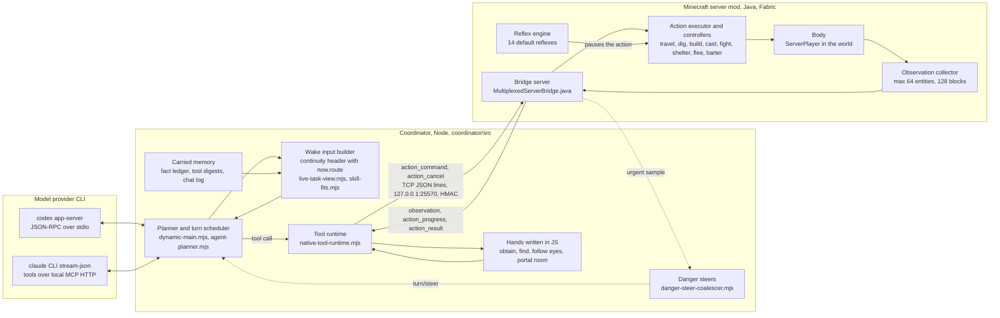
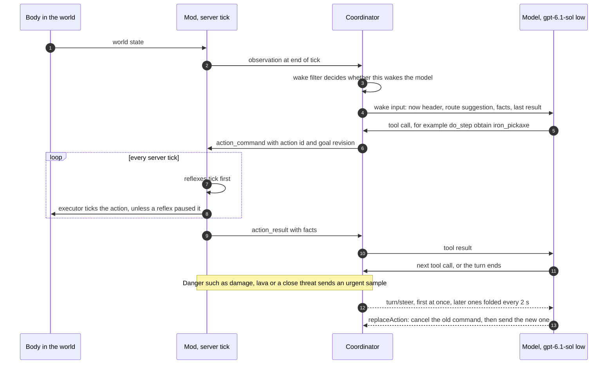
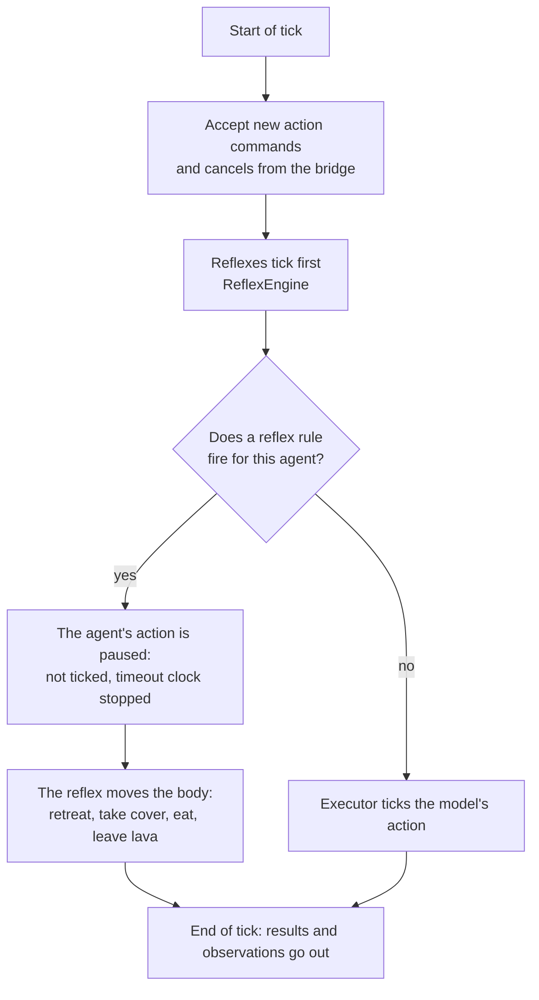
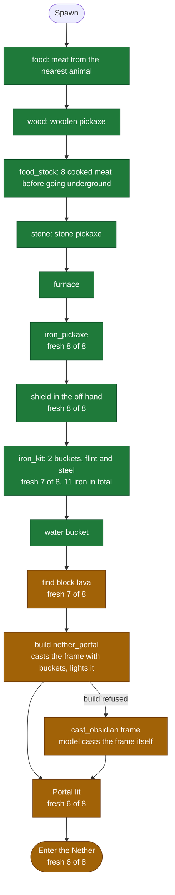
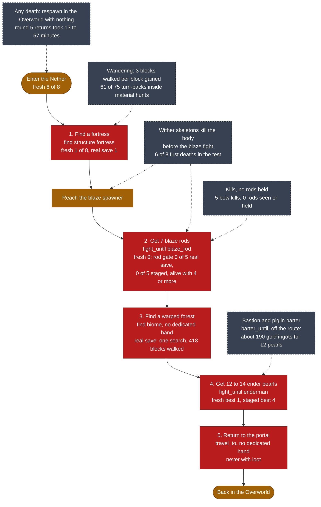
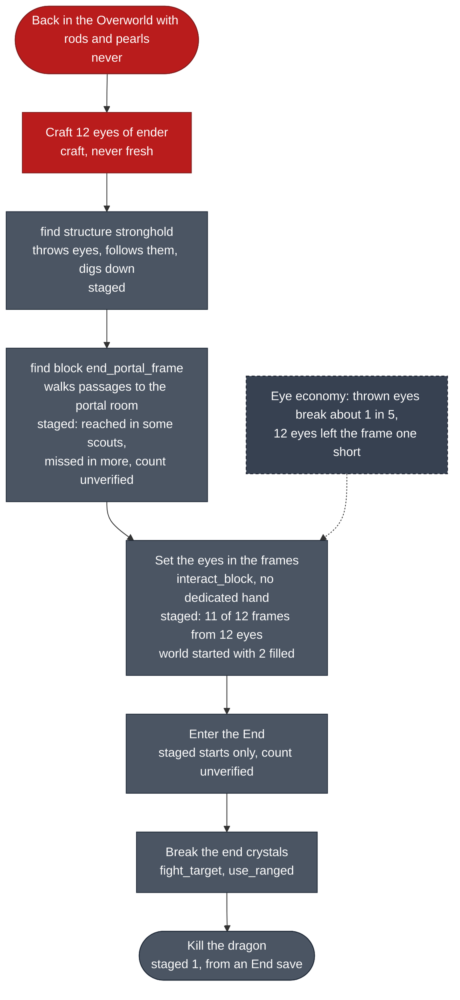

# Architecture: how the agent plays, and where a run from spawn stands

Written 15 Nov 2026 against base `c72db796` (`claude/sf-model-r2`). File references are to that commit.

Goal of the project: `gpt-6.1-sol` at low effort kills the Ender Dragon from a fresh spawn. The model decides every step. Skills are its hands, the route line only suggests, and nothing starts by itself.

## How to read the status tags

Each step in the three segment diagrams carries the best result so far and where it came from.

| Tag | Meaning |
|---|---|
| **fresh** | Reached in games played from spawn (rounds 4, 5 and 6, 14 to 15 Nov) |
| **real save** | Reached in a test that started from a save point taken out of a fresh game |
| **staged** | Reached only from a hand-prepared start with injected gear. Never counts as progress |
| **never** | Not reached by any game or test |

Colours: green = works from spawn, yellow = partly, red = the current walls, grey = seen only from staged starts.

## 1. System

Three processes: the model provider's CLI, the Node coordinator, and the Minecraft server with the mod. The body is a real `ServerPlayer`.

| Part | What it does | Where |
|---|---|---|
| Provider link | Codex: `codex app-server --stdio`, JSON-RPC (`thread/start`, `turn/start`, `turn/steer`, `turn/interrupt`). Claude: `claude --print` with stream-json and a per-agent MCP tool server on localhost | `codex-app-server.mjs:43`, `codex-service.mjs:241`, `claude-service.mjs:1915`, `claude-tool-server.mjs:67` |
| Tools the model sees | `do_step` with one verb (`travel_to`, `dig_to`, `mine`, `cast_obsidian`, `fight_until`, `build`, `build_shelter`, `barter_until`, `rest`, `gather`, `find`, `craft`, `smelt`, `obtain`, `repair_inventory`), and 31 more tools in the same list, among them `startAction`, `replaceAction`, `cancelAction`, `act`, `sequence`, `runProgram`, `observe`, `inspect`, `survey`, memory tools and `finish` | `native-minecraft-tools.mjs:110` |
| Route line | Suggests the usual next step for "beat the game" and starts nothing | `skill-fits.mjs:94`, `:184` |
| Bridge | TCP, JSON lines, bound to 127.0.0.1, default port 25570, HMAC-SHA256 challenge | `protocol-v2.mjs:625`, `MultiplexedServerBridge.java:110` |
| Body actions | 52 action types in the protocol enum | `protocol/ActionType.java:10`, `ServerActionExecutor.java:818` |
| Observation | Position, health, inventory, threats, entities, blocks, landmarks, current action, last result, reflex state | `ServerObservationCollector.java:176` |
| Carried memory | Fact ledger (12 entries), chat log (32 entries), tool digests that seed a new session after 64k tokens | `fact-ledger.mjs:9`, `conversation-memory.mjs:5`, `context-carry-over.mjs:16` |

## 2. One decision turn

Rules that hold the loop together:

- **One turn, one physical action.** Each agent has at most one model turn and one world action in flight.
- **Stale work is rejected.** Every command carries the goal revision and an action id; both sides refuse an old revision (`dynamic-main.mjs:3727`, `protocol-v2.mjs:100`).
- **Danger steers, it does not act.** The coordinator tells the model about danger; the model chooses (`danger-steer-coalescer.mjs:76`, `danger-glance.mjs:68`).
- **Reflexes do act.** They are the only part of the body that moves without the model asking.

### What happens inside one server tick

Source: `MultiplexedServerBridge.java:541` (`executeAcceptedInput`), `ServerActionExecutor.java:436`.

The 14 default reflexes (`reflexes.mjs:20`, also listed in `coordinator/config/minecraft-agent/AGENTS.md`): `default-lava`, `default-lava-flow`, `default-fire`, `default-air`, `default-edge`, `default-creeper`, `default-suffocate`, `default-fireball`, `default-arrow`, `default-retreat`, `default-eat`, `default-defend`, `default-blaze-cover`, `default-cover`. The model can switch each one off by name.

**Known fault in this loop (found 15 Nov, fix assigned to the portal lane).** `default-defend` fires only while no action is running. When the model replaces a command, the old one is cancelled first, so for a moment the body is idle. The reflex takes the body in that gap and the model's new command arrives already paused. `replaceAction` skips the reflex hand-off that a normal command gets (`native-tool-runtime.mjs:60`, `:1306`). In two STAGED test games (rod gate batch B, B4 and B3) the model asked to flee or build a shelter, the command never ran, and the body died 2.7 and 3.7 seconds later.

## 3. Overworld segment

The route rows are in `skill-fits.mjs:140`. The first row that is not done is the suggested step.

Numbers are round 5 (8 games, 14 Nov). Buckets were 8 of 8 but flint and steel 7 of 8, so the full kit is 7 of 8. Round 6 replayed six of those seeds and got 4 of 6 into the Nether, against 6 of 6 in round 5 on the same seeds. The portals also came much later. The cause is not established.

| Step | Hand | Where |
|---|---|---|
| Tools, furnace, buckets, shield, food | `obtain`, which plans gather, craft and smelt | `obtain-runner.mjs:325`, `obtain-plan.mjs` |
| Find lava | `find block minecraft:lava` | `find-search.mjs:438` |
| Build and light the portal | `build nether_portal` | `ServerBuildController.java:53` |
| Cast the frame directly | `cast_obsidian` with `frame:true` | `ServerCastObsidianController.java:54` |
| Enter a portal | No hand. `travel_to` detects standing in a portal | `ServerTravelController.java:413` |

Open in this segment: first Nether entry came at minute 35 to 173 in rounds 4 to 6, with time lost mostly to food trips, worn tools, flooded tunnels and deaths that reset the kit. Portal casting still fails in some real saves, when lava is out of reach or there is no dry spot to work from.

## 4. Nether segment

Every fresh game that reached the Nether ended here. In the Nether the route line has only three states (`skill-fits.mjs:227`): get blaze rods, then get pearls, then go home.

### The five blockers

| # | Blocker | Hand that exists | Best evidence | Named cause | Owner |
|---|---|---|---|---|---|
| 1 | Find a fortress | `find structure fortress`, with a fortress-floor walk for spawners (`find-search.mjs:1491`); `nether-regions.mjs:113` gives search facts | Fresh: 1 of 8 (round 5), 1 of 6 (round 6). Real save: found and entered once | The body wanders. 61 of 75 large turn-backs happened inside hunts for tools, chests, food or gold. `obtain` plans Overworld mobs while in the Nether (16 of 25 goals checked). A refused route is walked again and again | Portal lane after blocker 2; water-and-lava lane owns the Nether `obtain` fault |
| 2 | Get blaze rods | `fight_until` with built-in drop collection (`ServerFightUntilController.java:155`), `build_shelter`, `flee_from`, the `default-blaze-cover` reflex | Fresh: 0. Best in single tests: 4 held, then lost on death. Rod gate on base `9d10cedb`: 0 of 5 alive with 4+ rods on a real fortress save without armour, 0 of 5 on a STAGED fortress-with-gear save (lower deck, Y 65). 13 deaths; 6 of the 8 games that died were first killed by a wither skeleton; blazes were involved in 3 deaths | Wither skeletons kill first. A flee or shelter command sent while a reflex holds the body never runs (proven in 2 STAGED games, B3 and B4). Likely, not proven: rods from ranged kills are not collected. B1 and B5 made 5 bow kills and held 0 rods; no rod was seen | Portal lane (fix A, command hand-off), water-and-lava lane (fix B, ranged-kill fact and rod logging) |
| 3 | Find a warped forest or bastion | Generic `find biome` and `find structure`; `need-sources.mjs:607` names the sources | One real-save test made 31 legs toward a warped forest, walked 418 blocks for 101 net, and earned 1 pearl. Barter: three tests (two real save, one staged), 0 trades | No dedicated search hand. Bastions stay off the route by decision. Barter needs about 190 gold ingots for 12 pearls (`need-sources.mjs:18`, about 15.6 per pearl) | Survive lane, with blocker 4 |
| 4 | Get the pearls | Enderman hunt inside `fight_until` (`EndermanHuntLeads.java`); `barter_until` (`ServerBarterController.java`) | Fresh: 1 pearl, in two games (round 4 G7, round 6 G7). Tests: best 4 pearls held, from a staged forest start; one staged test got 3 enderman kills and 1 pearl | The hunt reports "no target seen" in real terrain. Fights work once a target is found | Survive lane, with blocker 3 |
| 5 | Return to the portal | None. The route says "return home through the portal" with no coordinates while in the Nether (`skill-fits.mjs:235`); the model uses `travel_to` | No game has carried rods or pearls back. Only returns after death are measured: 13 to 57 minutes in round 5, 10 to 58 in round 4 | Not yet read. The Overworld side of the route names the known portal's coordinates (`skill-fits.mjs:247`); the Nether side does not | Survive lane, after 3 and 4 (a read first) |

Two more walls sit across the whole segment and are not steps:

- **Death recovery.** In round 5, five games spent 265 minutes back in the Overworld after eight Nether deaths. There is no dedicated return hand; `respawn-recovery.mjs` gives facts only.
- **Armour.** Bodies mostly arrive with no armour: no armour at 10 of 12 Nether entries in round 5. A route step for a chestplate was merged and reverted on 15 Nov. In its one fresh test game the route row never showed; the model asked for a chestplate three times anyway and each obtain stopped (twice for danger, once with no source and a worn tool).

## 5. After the Nether: stronghold, the End, the dragon

No fresh game has reached this segment. Everything below comes from staged starts.

| Step | Hand | Where |
|---|---|---|
| Follow thrown eyes | `followEyes`, started by `find structure stronghold` | `find-eyes.mjs:36`, `EyeFlightObservation.java:25` |
| Reach the portal room | `findPortalRoom`, started by `find block end_portal_frame` | `find-portal-room.mjs:13` |
| Fill the frames, enter the End | No hand; `interact_block` and `travel_to` | |
| Dragon | No hand. Facts about perching and crystals, then `fight_target` and `use_ranged` | `dragon-fight-facts.mjs:21`, `ServerFightController.java:621` |

## 6. The whole run on one line

A full run needs every box in the same game. The green and yellow boxes work from spawn. The red boxes have never worked. The grey boxes have worked only from prepared starts, so "the End is solved" is not yet shown from a real run.

## Where the numbers come from

- Fresh games: rounds 4, 5 and 6 (8, 8 and 6 games, up to 180 minutes each, 14 to 15 Nov). Spend caps ended many games early.
- Rod gate: batch A played a real fortress save five times, batch B a STAGED fortress-with-gear save five times, on base `9d10cedb`, 15 Nov.
- Staged results: the staged scouts of 13 to 14 Nov, including the staged chain that made the first dragon kill (`retained-first-dragon-kill`). No fresh game has killed the dragon.
- Reads without the model: the Nether wandering audit, the `obtain` dimension check and the command-replacement read, all 15 Nov.
